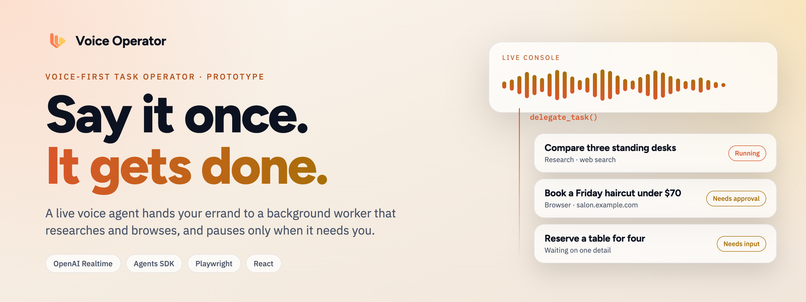
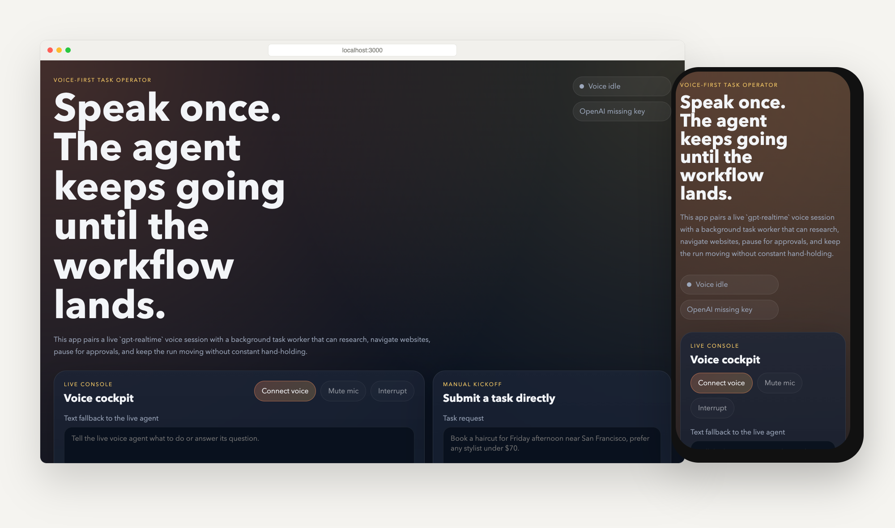
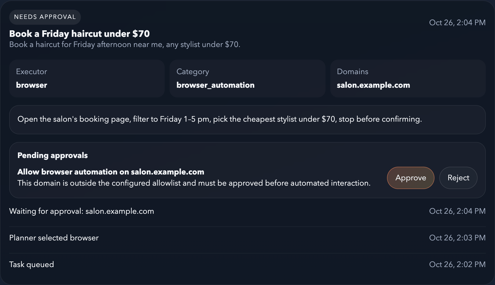
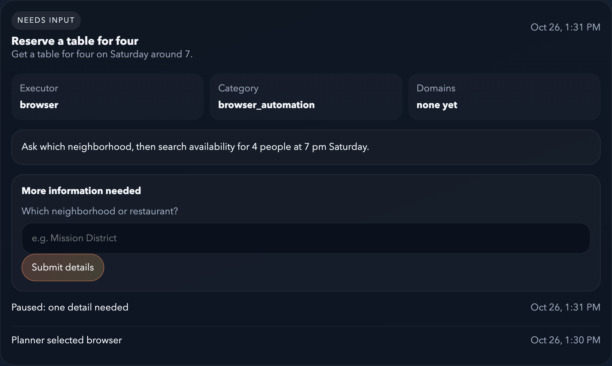
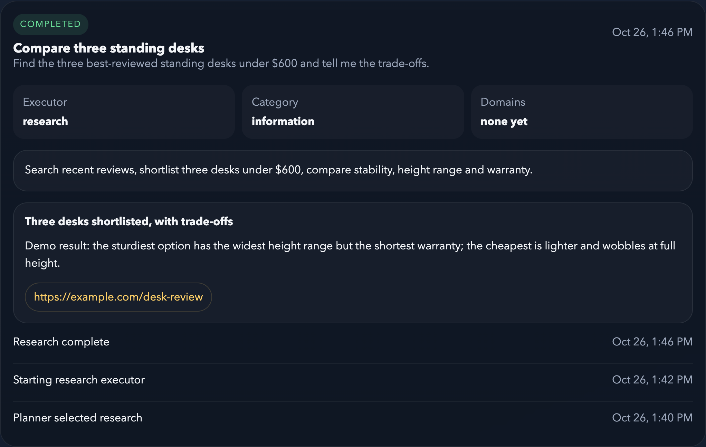

<p align="center">
  <picture>
    <source media="(prefers-color-scheme: dark)" srcset=".github/assets/banner-dark.png">
    
  </picture>
</p>

<p align="center">
  <strong>Talk to an agent that keeps working after you stop talking.</strong><br>
  Voice Operator turns a spoken request into a background task that researches the web or drives a browser, and only interrupts you for a missing detail or an approval.
</p>

<p align="center">
  <a href="#quick-start"><strong>Quick start</strong></a> ·
  <a href="#how-it-works"><strong>How it works</strong></a> ·
  <a href="#safety-by-default"><strong>Safety</strong></a> ·
  <a href="#honest-status"><strong>Status</strong></a>
</p>

<p align="center">
  
  
  
  
</p>

<p align="center">
  
</p>

## Why Voice Operator

Most voice assistants answer a question and stop. Real errands, like comparing products or booking a slot on a website, take many steps, and chat agents tend to stop and ask for confirmation at every one of them.

**Voice Operator splits the job in two.** A live voice agent listens and talks with you. As soon as it understands what you want, it hands the work to a background worker that plans, researches or browses, and keeps going on its own. You can hang up, keep talking, or check the task board.

<table>
  <tr>
    <td width="33%" valign="top">
      <h3>🎙️ Speak naturally</h3>
      A real-time voice session (<code>gpt-realtime</code>) with mute, interrupt and a text fallback. The voice agent asks only for details it truly needs.
    </td>
    <td width="33%" valign="top">
      <h3>🏃 Keeps going</h3>
      Tasks run in the background. A planner picks research, browser automation or both, and progress streams to a task board.
    </td>
    <td width="33%" valign="top">
      <h3>✋ Asks before it acts</h3>
      Sign-ins, payments, destructive steps, sensitive data and unfamiliar websites always wait for your yes or no.
    </td>
  </tr>
</table>

> **Say it once. It pauses only when it needs you.**

## A quick tour

Every task lands on the board with its plan, its executor and a live progress log. When it needs you, the card tells you exactly why.

<table>
  <tr>
    <td width="50%" valign="top">
      
      <h4>Approvals, not surprises</h4>
      A site outside your allowlist pauses the run until you approve it. The plan stops before anything is confirmed.
    </td>
    <td width="50%" valign="top">
      
      <h4>One question, then back to work</h4>
      Missing a detail? The task asks a single, specific question, by voice or on the card.
    </td>
  </tr>
  <tr>
    <td width="50%" valign="top">
      
      <h4>Results with sources</h4>
      Research tasks finish with a summary, details and the links they relied on. Browser tasks can attach a page screenshot.
    </td>
    <td width="50%" valign="top">
      <h4>What you can ask for</h4>

- 🔎 **Research:** "Find the three best-reviewed standing desks under $600."
- 🌐 **Browser tasks:** "Book a haircut for Friday afternoon, any stylist under $70."
- 🔀 **Mixed:** research first, then act on a website.
- 🗣️ **Follow-ups by voice:** "How is the haircut task going?"

    </td>
  </tr>
</table>

<sub>Screenshots are the real app running locally with no API key. The three tasks are synthetic demo data, and <code>salon.example.com</code> and <code>example.com</code> are placeholder domains.</sub>

## How it works

```text
 You ──voice──▶ Realtime voice agent ──delegate_task──▶ Task worker (Express)
                (browser, gpt-realtime)                    │
                      ▲                                    ├─ Task Router: plan, missing details, approvals
                      │  status, questions, approvals      ├─ Research Executor: web search
                      └────────────────────────────────────┤─ Browser Operator: Playwright (open, click, fill, read)
                                                           └─ Task store: .data/tasks.json
```

1. **Talk.** The browser opens a Realtime session using a client secret from the backend that expires after five minutes, so your API key never reaches the page.
2. **Delegate.** The voice agent has four tools: `delegate_task`, `get_task_status`, `provide_task_inputs` and `resolve_task_approval`.
3. **Plan.** A router agent (`gpt-5.4-pro` by default) classifies the request as research, browser, mixed, API or manual, lists any missing details, and flags approvals.
4. **Execute.** Research runs with the Agents SDK web-search tool. Browser tasks drive Chromium through Playwright with tools such as `open_website`, `click_element`, `fill_field` and `read_visible_text`, and can pause themselves mid-run.
5. **Report.** Progress, questions, approvals and results are saved locally and shown on the task board, which refreshes every few seconds.

## Safety by default

| Situation | What happens |
| --- | --- |
| Signing in to any account | ✋ Waits for your approval |
| Entering payment details or placing an order | ✋ Waits for your approval |
| Destructive or legally consequential actions | ✋ Waits for your approval |
| Particularly sensitive personal data | ✋ Waits for your approval |
| A website not on `ALLOWED_AUTOMATION_DOMAINS` | ✋ Waits for per-domain approval |
| A detail the task cannot guess | ❓ Asks one specific question |
| Anything else | 🏃 Keeps going |

Browser automation can be switched off entirely with `DISABLE_BROWSER_AUTOMATION=true`.

## Quick start

**You need:** Node.js 20.19+ (required by Vite 7), npm, and an OpenAI API key with Realtime access.

```bash
git clone https://github.com/mihirkavi/Agent.git
cd Agent
npm install
npx playwright install chromium
cp .env.example .env        # then set OPENAI_API_KEY in .env
npm run dev
```

Open <http://localhost:3000>, press **Connect voice** and allow the microphone. The frontend proxies API calls to the backend on port 8787. Without a key the interface still loads (it shows **OpenAI missing key**), but voice and tasks will not run.

| Command | What it does |
| --- | --- |
| `npm run dev` | Frontend (Vite, port 3000) and backend (port 8787) together |
| `npm run typecheck` | Type-checks the app and the server |
| `npm run build` then `npm start` | Production build of both, served by Node |

<details>
<summary><strong>Environment variables</strong></summary>
<br>

| Variable | Default | Purpose |
| --- | --- | --- |
| `OPENAI_API_KEY` | (empty) | Required for voice, planning, research and browsing |
| `OPENAI_REALTIME_MODEL` | `gpt-realtime` | Live voice model |
| `OPENAI_TASK_MODEL` | `gpt-5.4-pro` | Router and browser operator |
| `OPENAI_FAST_MODEL` | `gpt-5.4` | Research executor |
| `PORT` | `8787` | Backend port |
| `CLIENT_ORIGIN` | `http://localhost:3000` | Allowed CORS origin |
| `BROWSER_HEADLESS` | `true` | Set `false` to watch the browser work |
| `DISABLE_BROWSER_AUTOMATION` | `false` | Turn off Playwright tasks |
| `ALLOWED_AUTOMATION_DOMAINS` | `calendly.com,amazon.com,doordash.com` | Hostnames that skip the per-domain approval (other approvals still apply) |

</details>

<details>
<summary><strong>Backend API and project layout</strong></summary>
<br>

| Endpoint | Purpose |
| --- | --- |
| `GET /api/health` | Whether an OpenAI key is configured |
| `GET /api/tasks`, `GET /api/tasks/:id` | List tasks or read one |
| `POST /api/tasks` | Create a task from a request |
| `POST /api/tasks/:id/input` | Answer a task's questions |
| `POST /api/tasks/:id/approve` | Approve or reject a pending action |
| `POST /api/realtime/client-secret` | Mint a short-lived Realtime client secret |

| Path | What lives there |
| --- | --- |
| `src/` | React app: `App.tsx` (cockpit and task board), `hooks/useVoiceOperator.ts` (Realtime agent and tools) |
| `server/` | Express API, `task-runner.ts` (router, research and browser agents), `browser-controller.ts` (Playwright) |
| `shared/types.ts` | Task, approval and progress types shared by both sides |
| `.data/` | Local task store and screenshots (git-ignored) |

</details>

## Honest status

Voice Operator is a **local development prototype**:

- Voice, research and browsing need your own OpenAI key and **incur API charges**. There is no hosted demo.
- Task state lives in a single JSON file on your machine. There are **no user accounts, no multi-user isolation and no production hosting setup**.
- There is no automated test suite yet; `npm run typecheck` is the only check.
- Browser automation works on public websites and can still fail on complex pages, CAPTCHAs or bot detection. It is designed to stop before sign-ins, payments and other sensitive steps rather than complete them.
- Model names are configurable defaults; change them in `.env` if your account uses different ones.

<!-- project-artwork:start -->
## Project artwork

<p align="center">
  
  <br><sub>Conceptual artwork, not a product screenshot. <a href="assets/brand/README.md">Asset files, design notes and generation prompts</a>.</sub>
</p>
<!-- project-artwork:end -->

## License

No license file is included yet, so the default copyright rules apply and this README grants no reuse or redistribution rights. Contact the repository owner about permitted use.

<p align="center">
  <br>
  <br>
  <sub><strong>Voice Operator</strong> · Say it once. It gets done.</sub>
</p>
